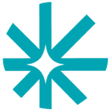
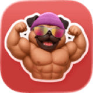
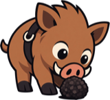
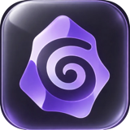
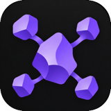
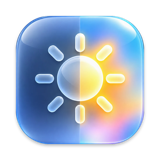

**Building AI agents that save time.** Independent AI Engineer behind [Brock.chat](https://brock.chat) and [Personalize.design](https://www.personalize.design).

 

---

### 👋 About

AI Infrastructure & Automation Engineer, with 4+ years of running and automating infrastructure. Now focused on **AI agents**: LLM agents, RAG and MCP, taken all the way to production.

- 🤖 **Focus:** AI agents, harness optimization, RAG, MCP
- ⚙️ **Background:** infrastructure, automation, reliability
- 📍 **Based in:** Paris, France

### 🏢 What I'm building

| | Product | What it does |
|:---:|---|---|
|  | [**Personalize.design**](https://www.personalize.design) | AI-powered product personalization for e-commerce. Generates designs, previews and print-ready files for Shopify stores. |
|  | [**Brock.chat**](https://brock.chat) | A health AI agent you talk to over iMessage, with persistent memory, harness optimization and async workflows. |

### 🛠️ Stack

### 🚀 My open source projects

| | Project | What it does |
|:---:|---|---|
|  | [**Truffle**](https://github.com/Azilone/Truffle) | Find any file by name, content or meaning. Instantly, offline. |
|  | [**Dailies**](https://github.com/Azilone/Dailies) | Prepare camera media safely, from Raycast. |
|  | [**Muesli**](https://github.com/Azilone/obsidian-muesli) | Granola in Obsidian. Meeting notes in your vault, no bot. |
|  | [**Native Mindmap**](https://github.com/Azilone/obsidian-native-mindmap) | Keyboard-first mindmaps stored as plain Markdown. |
|  | [**Lucent**](https://github.com/Azilone/Lucent) | Unlock the full XDR brightness of your MacBook Pro. |

### 📫 Contact

<a href="https://x.com/Azil0ne"><picture><source media="(prefers-color-scheme: light)" srcset="assets/logos/x-light.svg"></picture></a>
&nbsp;&nbsp;&nbsp;

