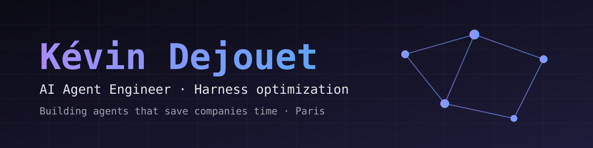

**Building AI agents that save companies time.** Independent AI Engineer behind [Brock.chat](https://brock.chat) and [Personalize.design](https://www.personalize.design).

---

### 👋 About

AI Infrastructure & Automation Engineer, with 4+ years of running and automating infrastructure. Now focused on **AI agents**: LLM agents, RAG and MCP, taken all the way to production.

- 🤖 **Focus:** AI agents, harness optimization, RAG, MCP
- ⚙️ **Background:** infrastructure, automation, reliability
- 📍 **Based in:** Paris, France

### 🏢 What I'm building

| Product | What it does |
|---|---|
| [**Personalize.design**](https://www.personalize.design) | AI-powered product personalization for e-commerce. Generates designs, previews and print-ready files for Shopify stores. |
| [**Brock.chat**](https://brock.chat) | An AI agent you talk to over iMessage, with persistent memory, harness optimization and async workflows. |

### 🛠️ Stack

### 🚀 Open source

| Project | What it does |
|---|---|
| [**Truffle**](https://github.com/Azilone/Truffle) | Find any file by name, content or meaning. Instantly, offline. |
| [**Dailies**](https://github.com/Azilone/Dailies) | Prepare camera media safely, from Raycast. |
| [**Muesli**](https://github.com/Azilone/obsidian-muesli) | Granola in Obsidian. Meeting notes in your vault, no bot. |
| [**Native Mindmap**](https://github.com/Azilone/obsidian-native-mindmap) | Keyboard-first mindmaps stored as plain Markdown. |
| [**Lucent**](https://github.com/Azilone/Lucent) | Unlock the full XDR brightness of your MacBook Pro. |

### 📈 Activity

### 🤝 Connect with me

